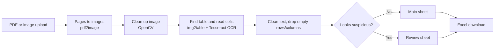

# DocTableExtractor

**Turns tables in scanned PDFs and images into clean Excel files, and flags rows that OCR may have misread for a person to check.**

Built for documents such as handover sheets and lists where the table is a picture, not selectable text.

## How it works



| Step | File |
|---|---|
| Convert PDF pages to images | `preprocess.py` |
| Improve contrast and remove noise before OCR | `preprocess.py` |
| Detect the table and read each cell | `extractor.py` |
| Clean text, name columns, split rows needing review | `cleaner.py` |
| Build the Excel file (main + review sheets) | `exporter.py` |
| Run the steps end to end | `pipeline.py` |
| Upload and download interface | `app.py` (Streamlit) |

A row goes to the **review sheet** when it is very short, contains several `?`, or has many stray symbols, which usually means OCR misread it.

## Run locally

Install the two system tools first:

- **Tesseract OCR**: `sudo apt install tesseract-ocr` (Linux), `brew install tesseract` (macOS), or the Windows installer
- **Poppler** (PDF to image): `sudo apt install poppler-utils`, `brew install poppler`, or the Windows build

```bash
python -m venv .venv
source .venv/bin/activate          # Windows: .venv\Scripts\activate
pip install -r requirements.txt
cp .env.example .env               # only if the tools are not on PATH
streamlit run app.py
```

## Tests

```bash
pip install pytest
python -m pytest -q tests
```

Tests cover text cleaning, blank row and column removal, column naming and the review-row rules.

## Privacy

Use sample or de-identified documents. Tables such as patient lists contain personal health information; do not upload real records to a hosted copy of this app.

## License

MIT, see [LICENSE](LICENSE). Built by [Lavanya Srivastava](https://github.com/lavanya1402), Lavanya AI Consultancy.
